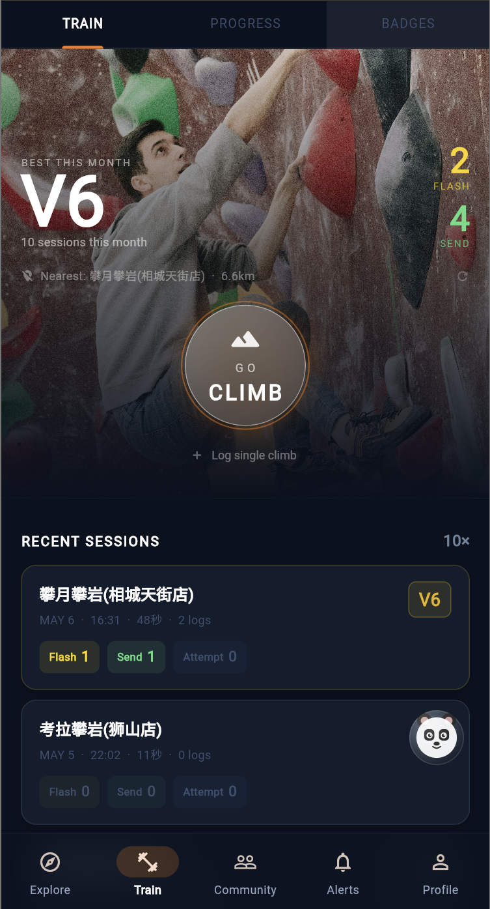

# BetaUp

**English** · [简体中文](./README.zh-CN.md)


**A full-stack app for indoor climbers and their coaches.** BetaUp connects what happens at the wall with what happens after a session. Climbers can log an attempt by voice, see how their grades change over time, share the moves that worked, and get feedback on their training.

[Project portfolio](https://alinayuhan.github.io/betaup/) · [Demo video](https://github.com/AlinaYuhan/betaup/releases/download/v1.0-demo/betaup_video.mp4) · [Hosted prototype](https://web-liart-sigma-79.vercel.app/)

## A session with BetaUp

- 🧗 **Log a climb.** Record the grade and outcome, or tell Panda, the voice assistant, to log it after an attempt.
- 🏅 **Review progress.** See session history, grade trends, and milestone badges.
- 👥 **Share beta.** Post route-specific tips, photos, or videos and discover nearby gyms on the map. In climbing, *beta* means advice on how to complete a route.
- 🏫 **Train with a coach.** Verified coaches can review training records and send feedback or plans.

<p align="center">
  <a href="./assets/photos/screenshot-train.png"></a>
  <br>
  <em>The Train tab brings session logging, recent climbs, and Panda into one screen.</em>
</p>

## How it works

| Layer | Implementation |
| --- | --- |
| Client | [Flutter and Dart](./mobile_flutter) for web and mobile |
| API | [Spring Boot 3.5 and Java 21](./backend), with JWT-based access for climbers, coaches, and admins |
| Data | Spring Data JPA and file-backed H2 for local development |
| Voice | Speech recognition captures the command. DeepSeek interprets the request for supported actions such as logging a climb or checking training stats. |

## Tested with climbers and a coach

In a think-aloud test with two climbers and one coach, all three completed the progress-dashboard task and two completed the voice-logging task. The team revised the voice entry point and the Train screen after observing where participants got stuck. [See the evaluation and design iterations.](https://alinayuhan.github.io/betaup/#evaluation)

## Team

A four-person project for CPT208 Human-Centric Computing at Xi’an Jiaotong-Liverpool University.

**[Yuhan Cao](https://github.com/AlinaYuhan), team lead and lead developer.** Led the system architecture and database design, built the Spring Boot API and core Flutter workflows, and integrated authentication, achievements, and Panda.

[Renyu Yang](https://github.com/Renyuuu) · User research<br>
[Zixi Chen](https://github.com/czx6365) · UI/UX design and prototyping<br>
[Mengxi Yang](https://github.com/sunnydayyy774) · Usability evaluation

[Detailed team contributions](https://alinayuhan.github.io/betaup/#system)

## Run locally

With JDK 21, Flutter, and Chrome installed, run the API and client in separate terminals from the repository root.

```bash
cd backend
./mvnw spring-boot:run
```

```bash
cd mobile_flutter
flutter pub get
flutter run -d chrome --dart-define=BETAUP_API_BASE_URL=http://localhost:8080/api
```

The default development profile uses a local H2 database. Set `BETAUP_DEEPSEEK_API_KEY` in the backend environment to enable DeepSeek requests. The course project’s [AI development logs](./ai-logs/) are also available.
