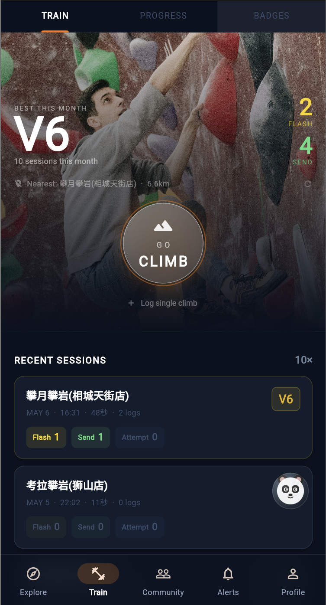

# BetaUp

[English](./README.md) · **简体中文**


**面向室内攀岩者和教练的全栈应用。** BetaUp 把岩馆里的每次尝试和训练后的复盘连起来。攀岩者可以用语音记录攀爬、查看难度进步、分享过线技巧，也可以接收教练反馈。

[项目主页](https://alinayuhan.github.io/betaup/) · [演示视频](https://github.com/AlinaYuhan/betaup/releases/download/v1.0-demo/betaup_video.mp4) · [在线原型](https://web-liart-sigma-79.vercel.app/)

## 一次训练怎么用

- 🧗 **记录攀爬。** 手动录入线路难度和结果，也可以在攀爬后告诉 Panda 语音助手。
- 🏅 **复盘进度。** 查看训练历史、难度变化和里程碑徽章。
- 👥 **分享 Beta。** 发布具体线路的技巧、照片或视频，也可以在地图上查找附近岩馆。攀岩里的 *beta* 是指完成线路的动作方法或建议。
- 🏫 **与教练协作。** 认证教练可查看训练记录，发送反馈或训练计划。

<p align="center">
  <a href="./assets/photos/screenshot-train.png"></a>
  <br>
  <em>训练页集中展示记录入口、近期攀爬和 Panda 语音助手。</em>
</p>

## 技术实现

| 模块 | 实现 |
| --- | --- |
| 客户端 | [Flutter 与 Dart](./mobile_flutter)，支持 Web 和移动端 |
| API | [Spring Boot 3.5 与 Java 21](./backend)，通过 JWT 区分攀岩者、教练和管理员权限 |
| 数据 | Spring Data JPA，本地开发默认使用文件型 H2 数据库 |
| 语音 | 语音识别获取指令，DeepSeek 解析记录攀爬、查询训练统计等受支持的请求。 |

## 可用性测试与迭代

两位攀岩者和一位教练参加了出声思考测试。三位都完成了进度仪表盘任务，两位完成了语音记录任务。团队根据测试中观察到的操作障碍，调整了语音入口和训练页。[查看评估结果和界面迭代。](https://alinayuhan.github.io/betaup/#evaluation)

## 项目团队

西交利物浦大学 CPT208 Human-Centric Computing 四人小组项目。

**[曹雨涵](https://github.com/AlinaYuhan)，组长兼主开发。** 主导系统架构和数据库设计，开发 Spring Boot API 与 Flutter 核心流程，集成认证、成就系统和 Panda 语音助手。

[杨仁雨](https://github.com/Renyuuu) · 用户研究<br>
[陈子熹](https://github.com/czx6365) · UI/UX 设计与原型<br>
[杨梦溪](https://github.com/sunnydayyy774) · 可用性评估

[查看团队详细分工](https://alinayuhan.github.io/betaup/#system)

## 本地运行

安装 JDK 21、Flutter 和 Chrome。从仓库根目录分别启动后端和客户端。

```bash
cd backend
./mvnw spring-boot:run
```

```bash
cd mobile_flutter
flutter pub get
flutter run -d chrome --dart-define=BETAUP_API_BASE_URL=http://localhost:8080/api
```

默认开发环境使用本地 H2 数据库。若需启用 DeepSeek 请求，请在后端环境中设置 `BETAUP_DEEPSEEK_API_KEY`。另见课程项目的 [AI 开发日志](./ai-logs/)。
